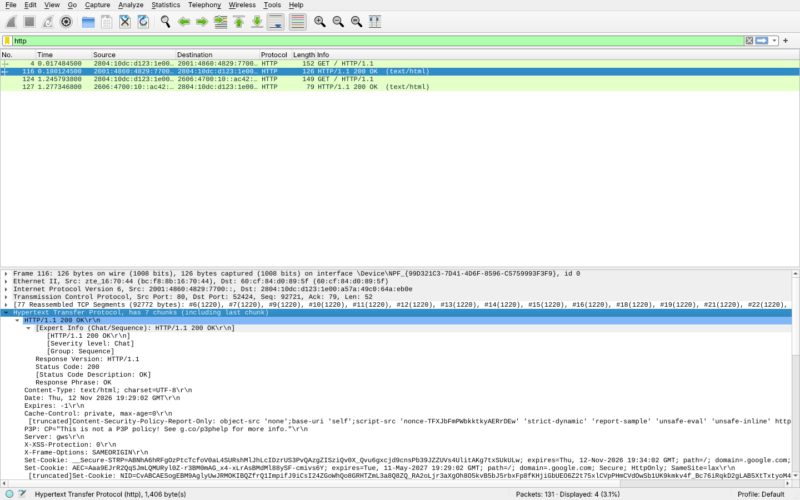

# Exercício 5 — Tráfego HTTP

**Arquivos deste diretório:** `captura_http.pcapng` (captura) e `print_wireshark.png` (captura de tela com os pacotes destacados).

## Dependências

```bash
sudo apt install wireshark      # durante a instalação, permita que usuários comuns capturem
sudo usermod -aG wireshark $USER   # depois faça logout/login
```

## ⚠ Antes de começar: HTTP x HTTPS

Hoje o `www.google.com` (e quase todo site) usa **HTTPS**, que é criptografado: o filtro `http` não mostra nada, só aparece `tls`. Para enxergar os cabeçalhos HTTP é preciso acessar um site **sem** criptografia. Use uma das opções:

- **Opção A (recomendada, sempre funciona):** servidor local do Python na porta 8080 (que o Wireshark já reconhece como HTTP):
  ```bash
  python3 -m http.server 8080
  ```
  e no navegador abra `http://localhost:8080`. Capture na interface **Loopback: lo**.
- **Opção B (site remoto):** `http://neverssl.com` ou `http://example.com`, capturando na interface de rede (Wi-Fi/Ethernet). Se o navegador trocar sozinho para HTTPS, rode no terminal `curl -v http://example.com` durante a captura.

## Como reproduzir a captura

No Windows, o script `scripts/CAPTURAR.bat` faz esta captura automaticamente (foi assim que a captura deste diretório foi feita). Roteiro manual no Linux:


1. Abra o Wireshark e inicie a captura na interface certa (`lo` para a opção A, `wlan0`/`eth0`/`enp...` para a opção B).
2. Acesse o site pelo navegador (ou `curl`).
3. Pare a captura (botão vermelho).
4. Digite o filtro `http` e tecle Enter.
5. Clique na requisição (`GET / HTTP/1.1`) e expanda **Hypertext Transfer Protocol** para ver: **método** e **URL** (`Request Method`, `Request URI`, `Host`).
6. Clique na resposta (`HTTP/1.x 200 OK`) e veja: **código de status**, **Content-Type** e **Server**.
7. Salve: *File → Save As* → `captura_http.pcapng` neste diretório.
8. Tire um print com a requisição e a resposta destacadas e salve como `print_wireshark.png`.

Filtros úteis:
```
http
http.request.method == "GET"
http.response.code == 200
```

Conferência pelo terminal (opcional):
```bash
tshark -r captura_http.pcapng -Y http -T fields \
  -e http.request.method -e http.host -e http.request.uri \
  -e http.response.code -e http.content_type -e http.server
```

## Observações

**Ambiente da captura:** feita em 12/11/2026 no computador do Aaron (Windows, placa Ethernet Realtek 2.5GbE, IP `192.168.1.11`, rede doméstica com roteador `192.168.1.1`), com o Wireshark 4.6.9 (dumpcap + Npcap 1.90), pelo script `scripts/CAPTURAR.bat`. O site foi acessado por HTTP sem criptografia com o `curl` (`curl http://www.google.com/` e `curl http://example.com/`), porque o navegador troca sozinho para HTTPS e aí os cabeçalhos ficam cifrados. Filtro de captura `tcp port 80`. Arquivo: `captura_http.pcapng` (131 pacotes).



Com o filtro `http` restaram 4 pacotes. O pacote **nº 4** é a requisição: método **GET**, URL **`http://www.google.com/`** (cabeçalho `Host: www.google.com`, URI `/`). O pacote **nº 116** é a resposta do Google, com código de status **`200 OK`** (HTTP/1.1), **`Content-Type: text/html; charset=UTF-8`** e **`Server: gws`** (Google Web Server). Ela chegou 0,16 s depois da requisição e veio dividida em 77 segmentos TCP (cerca de 92 KB), que o Wireshark remonta. Os pacotes **nº 124** e **nº 127** repetem o processo com `http://example.com/`: `GET /`, resposta `200 OK`, `Content-Type: text/html; charset=utf-8` e `Server: cloudflare`, em 32 ms. A comunicação usou **IPv6**, pois o provedor fornece endereço IPv6 e o Windows dá preferência a ele. Antes de cada requisição aparece o three-way handshake TCP na porta 80, já que o HTTP roda sobre o TCP.
