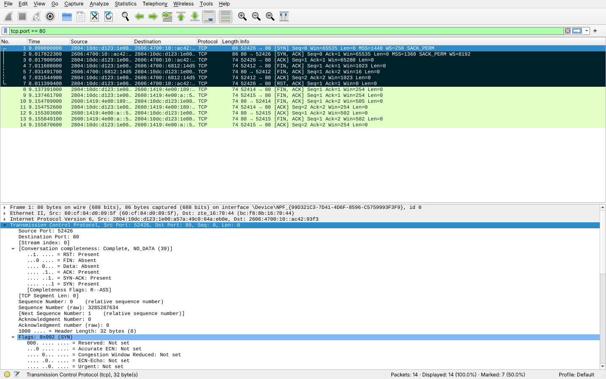

# Exercício 6 — Estabelecimento e Encerramento de Conexão TCP

**Arquivos deste diretório:** `captura_tcp.pcapng` (captura) e `print_wireshark.png` (captura de tela com o handshake e o encerramento destacados).

## Dependências

```bash
sudo apt install wireshark telnet
```

## Como reproduzir a captura

No Windows, o script `scripts/CAPTURAR.bat` faz esta captura automaticamente (foi assim que a captura deste diretório foi feita). Roteiro manual no Linux:


1. Abra o Wireshark e inicie a captura na interface de rede (Wi-Fi/Ethernet).
2. No terminal, conecte com telnet na porta 80 de um servidor web:
   ```bash
   telnet example.com 80
   ```
3. Quando aparecer `Connected to example.com`, digite as linhas abaixo e tecle **Enter duas vezes** no final:
   ```
   GET / HTTP/1.1
   Host: example.com
   Connection: close

   ```
   O servidor responde e fecha a conexão (gera os pacotes FIN). Se preferir, apenas conecte e saia com `Ctrl+]` e depois `quit`.
4. Pare a captura.
5. Aplique o filtro abaixo para ver só os pacotes de abertura e fechamento:
   ```
   tcp.port == 80 && (tcp.flags.syn == 1 || tcp.flags.fin == 1 || tcp.flags.reset == 1)
   ```
   Para ver a conversa inteira: clique com o botão direito em um pacote → *Follow → TCP Stream*, ou use `tcp.stream == 0`.
6. Identifique:
   - **Three-way handshake:** `[SYN]` (cliente → servidor), `[SYN, ACK]` (servidor → cliente), `[ACK]` (cliente → servidor).
   - **Encerramento:** `[FIN, ACK]` de um lado, `[ACK]` do outro, `[FIN, ACK]` do outro lado e `[ACK]` final (ou `[RST]` se a conexão for abortada).
7. Salve como `captura_tcp.pcapng` neste diretório e tire o print (`print_wireshark.png`) destacando esses pacotes (botão direito → *Mark Packet* ajuda a destacar).

**Alternativa local** (sem depender de internet): em um terminal `sudo python3 -m http.server 80`, em outro `telnet localhost 80`, capturando na interface `lo`.

Conferência pelo terminal (opcional):
```bash
tshark -r captura_tcp.pcapng -Y "tcp.flags.syn==1 || tcp.flags.fin==1 || tcp.flags.reset==1" \
  -T fields -e frame.number -e ip.src -e ip.dst -e tcp.flags.str -e tcp.seq -e tcp.ack
```

## Observações

**Ambiente da captura:** feita em 12/11/2026 no computador do Aaron (Windows, placa Ethernet Realtek 2.5GbE, IP `192.168.1.11`, rede doméstica com roteador `192.168.1.1`), com o Wireshark 4.6.9 (dumpcap + Npcap 1.90), pelo script `scripts/CAPTURAR.bat`. O script executou `telnet example.com 80` (cliente telnet do Windows), deixou a conexão aberta por 8 segundos e fechou o telnet. Filtro de captura `tcp port 80`. Arquivo: `captura_tcp.pcapng` (14 pacotes).



No print estão marcados (fundo escuro) os pacotes de abertura e de fechamento. A conexão do telnet usou a porta de origem **52426** e o IPv6 `2606:4700:10::ac42:93f3` do example.com. O **three-way handshake** são os pacotes **nº 1 `[SYN]`** (cliente, Seq=0, MSS=1440), **nº 2 `[SYN, ACK]`** (servidor, Seq=0, Ack=1, MSS=1360) e **nº 3 `[ACK]`** (cliente, Ack=1), em 18 ms. Os números de sequência iniciais reais foram 3285287634 (cliente) e 2367410244 (servidor). Como nenhum dado foi digitado, a conexão ficou parada até o telnet ser fechado. Ela então terminou de forma **abrupta**, com o pacote **nº 7 `[RST, ACK]`** enviado pelo cliente: o RST encerra a conexão na hora, sem a troca de FIN. A mesma captura também mostra o **encerramento normal** de outras conexões HTTP do computador. Na porta 52412 (pacotes **nº 4 `[FIN, ACK]`** do cliente, **nº 5 `[FIN, ACK]`** do servidor e **nº 6 `[ACK]`**) o servidor juntou o ACK e o seu FIN em um só segmento. Na porta 52415 aparecem os quatro segmentos clássicos: **nº 9 FIN**, **nº 12 ACK**, **nº 13 FIN** e **nº 14 ACK**.
