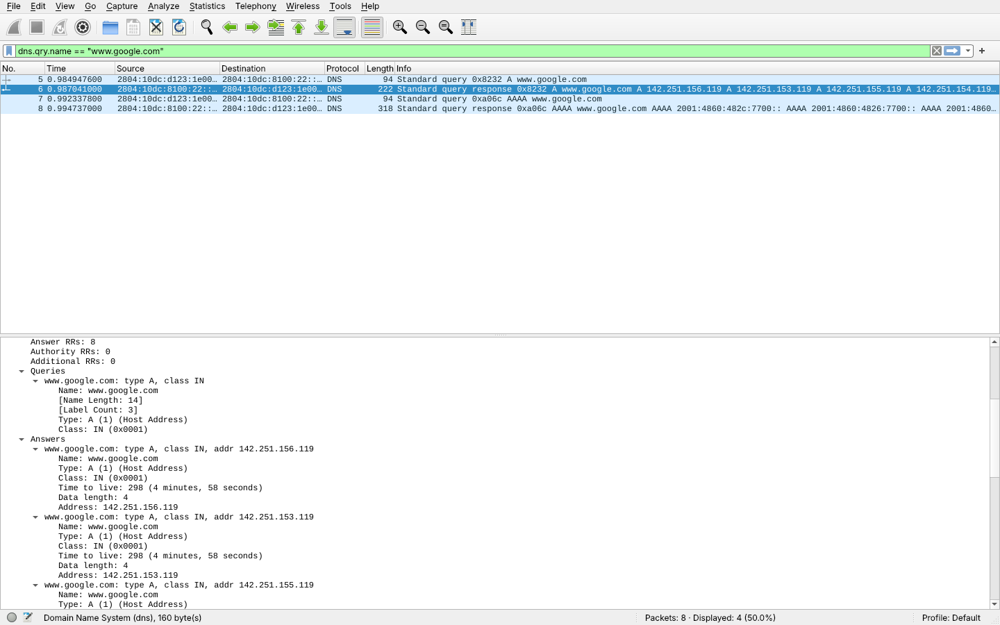

# Exercício 7 — Resolução de Nomes via DNS

**Arquivos deste diretório:** `captura_dns.pcapng` (captura) e `print_wireshark.png` (captura de tela com a consulta e a resposta destacadas).

## Dependências

```bash
sudo apt install wireshark dnsutils   # dnsutils traz o comando dig (opcional)
```

## ⚠ Antes de começar

- **DNS seguro do navegador:** Chrome e Firefox podem usar *DNS over HTTPS*; aí as consultas ficam criptografadas e o filtro `dns` não mostra nada. Desative em *Configurações → Privacidade e segurança → Usar DNS seguro* (Chrome) ou *DNS por HTTPS* (Firefox), ou faça a consulta também pelo terminal com `dig`.
- **Cache:** se o nome já estiver em cache, não sai consulta nova. Limpe antes:
  ```bash
  resolvectl flush-caches
  ```
- **Interface:** no Ubuntu, o sistema consulta primeiro o `127.0.0.53` (systemd-resolved), que repassa para o DNS real. Capture na interface **any** para ver as duas etapas.

## Como reproduzir a captura

No Windows, o script `scripts/CAPTURAR.bat` faz esta captura automaticamente (foi assim que a captura deste diretório foi feita). Roteiro manual no Linux:


1. `resolvectl flush-caches`
2. Abra o Wireshark e inicie a captura na interface `any`.
3. Acesse `www.google.com` no navegador (e, se quiser garantir, rode também `dig www.google.com` e `dig AAAA www.google.com`).
4. Pare a captura e aplique o filtro:
   ```
   dns && dns.qry.name contains "google"
   ```
5. Clique na consulta (*Standard query*) e expanda **Domain Name System → Queries**: veja o **tipo do registro** (`A` = IPv4, `AAAA` = IPv6, `HTTPS`/`CNAME`...).
6. O **servidor DNS utilizado** é o IP de destino da consulta (coluna *Destination*). Confira com `resolvectl status`.
7. Clique na resposta (*Standard query response*) e expanda **Answers**: veja os **registros retornados** (IP, TTL, CNAME).
8. Salve como `captura_dns.pcapng` neste diretório e tire o print (`print_wireshark.png`).

Conferência pelo terminal (opcional):
```bash
tshark -r captura_dns.pcapng -Y dns -T fields \
  -e frame.number -e ip.src -e ip.dst -e dns.flags.response \
  -e dns.qry.name -e dns.qry.type -e dns.a -e dns.aaaa -e dns.cname
```

## Observações

**Ambiente da captura:** feita em 12/11/2026 no computador do Aaron (Windows, placa Ethernet Realtek 2.5GbE, IP `192.168.1.11`, rede doméstica com roteador `192.168.1.1`), com o Wireshark 4.6.9 (dumpcap + Npcap 1.90), pelo script `scripts/CAPTURAR.bat`. O cache DNS foi limpo (`ipconfig /flushdns`) e depois `www.google.com` foi resolvido com `Resolve-DnsName` (tipos A e AAAA). Filtro de captura `port 53`. Arquivo: `captura_dns.pcapng` (8 pacotes).



Com o filtro `dns.qry.name == "www.google.com"` aparecem duas consultas e duas respostas. O **pacote nº 5** consulta o registro do tipo **`A`** (endereço IPv4) e o **pacote nº 7** o tipo **`AAAA`** (endereço IPv6). O **servidor DNS utilizado foi `2804:10dc:8100:22::22`**, o DNS do provedor de internet, acessado por IPv6 na porta **UDP 53**. Pelo DHCP o provedor também informa os DNS IPv4 `177.74.225.22` e `177.74.224.29`. A resposta **nº 6** trouxe **8 registros A** (`142.251.150.119` a `142.251.157.119`, TTL de **298 s**) e a resposta **nº 8** trouxe **8 registros AAAA** (`2001:4860:4826:7700::` a `2001:4860:482d:7700::`, TTL de **288 s**). O Google devolve vários endereços para distribuir a carga entre servidores. Cada resposta chegou em cerca de 2 ms, e não houve registro CNAME. Os pacotes 1 a 4, que não passam no filtro, são consultas que o próprio Windows fez em segundo plano (`storeedgefd.dsx.mp.microsoft.com`, da Microsoft Store).
