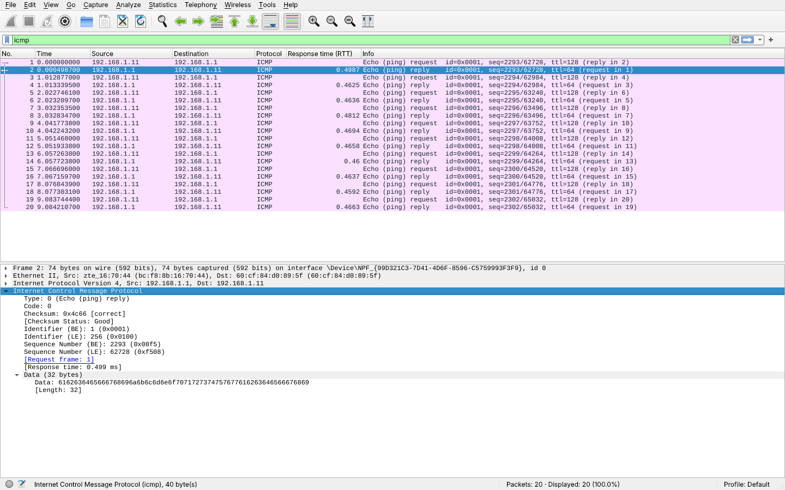

# Exercício 8 — Tráfego ICMP (ping)

**Arquivos deste diretório:** `captura_icmp.pcapng` (captura) e `print_wireshark.png` (captura de tela com os pacotes e o RTT destacados).

## Dependências

```bash
sudo apt install wireshark iputils-ping
```

## Como reproduzir a captura

No Windows, o script `scripts/CAPTURAR.bat` faz esta captura automaticamente (foi assim que a captura deste diretório foi feita). Roteiro manual no Linux:


1. Descubra um computador da sua rede para testar. O mais fácil é o roteador (gateway):
   ```bash
   ip route | grep default      # o IP depois de "via" é o gateway, ex.: 192.168.0.1
   ```
2. Abra o Wireshark e inicie a captura na interface de rede (Wi-Fi/Ethernet).
3. Envie 10 pings:
   ```bash
   ping -c 10 192.168.0.1
   ```
4. Pare a captura e aplique o filtro `icmp`.
5. Os pacotes aparecem em pares: **Echo (ping) request** (tipo 8) e **Echo (ping) reply** (tipo 0), com o mesmo número de sequência (`seq`).
6. **RTT:** clique em um *reply* e expanda **Internet Control Message Protocol**: o campo **Response time** é o tempo de ida e volta daquele pacote. Para ver todos de uma vez, clique com o botão direito em *Response time → Apply as Column*.
7. Compare com os valores `time=` que o próprio `ping` mostrou no terminal.
8. Salve como `captura_icmp.pcapng` neste diretório e tire o print (`print_wireshark.png`) com a coluna de RTT visível.

Conferência pelo terminal (opcional):
```bash
tshark -r captura_icmp.pcapng -Y "icmp.type == 0" -T fields \
  -e icmp.seq -e ip.src -e icmp.resptime
```

## Observações

**Ambiente da captura:** feita em 12/11/2026 no computador do Aaron (Windows, placa Ethernet Realtek 2.5GbE, IP `192.168.1.11`, rede doméstica com roteador `192.168.1.1`), com o Wireshark 4.6.9 (dumpcap + Npcap 1.90), pelo script `scripts/CAPTURAR.bat`. O script executou `ping -n 10 192.168.1.1`, testando a conectividade com o roteador da rede. Filtro de captura `icmp`. Arquivo: `captura_icmp.pcapng` (20 pacotes).



Foram enviados **10 pacotes *Echo (ping) request*** (ICMP tipo 8) de `192.168.1.11` para `192.168.1.1` e recebidas **10 respostas *Echo (ping) reply*** (tipo 0), **sem perda**. Cada par é ligado pelo identificador (`id=0x0001`) e pelo número de sequência (2293 a 2302). Na coluna *Response time (RTT)*, o tempo de ida e volta ficou entre **0,459 ms e 0,499 ms**, com média de **0,469 ms**, um valor baixo por ser um equipamento da própria rede local ligado por cabo. O `ping` do Windows mostrou apenas `tempo<1ms`, porque mede em milissegundos inteiros. O TTL das requisições é 128, padrão do Windows, e o das respostas é 64, padrão de sistemas baseados em Linux como o roteador. O ICMP não usa portas, pois funciona diretamente sobre o IP.
