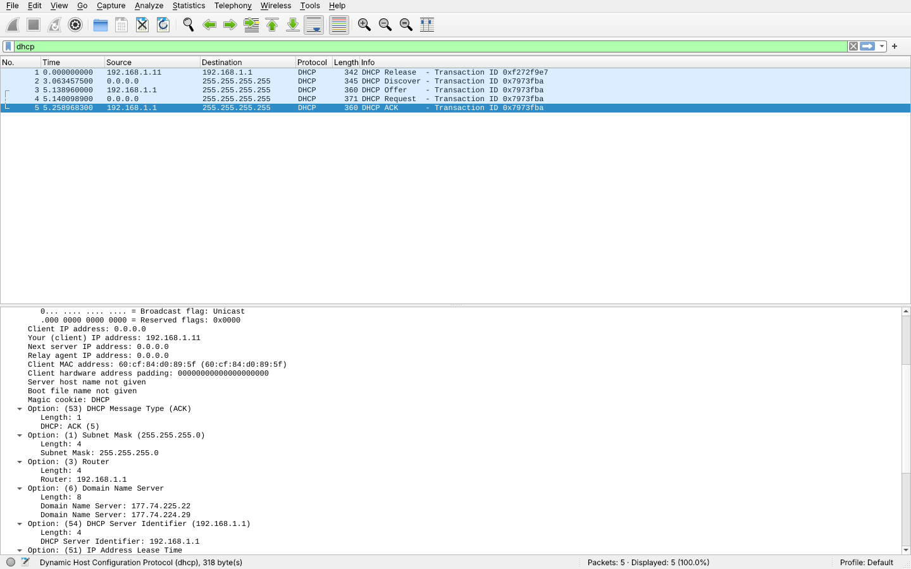

# Exercício 9 — Tráfego DHCP

**Arquivos deste diretório:** `captura_dhcp.pcapng` (captura) e `print_wireshark.png` (captura de tela com as quatro mensagens DORA destacadas).

## Dependências

```bash
sudo apt install wireshark isc-dhcp-client   # isc-dhcp-client traz o comando dhclient
```

## Como reproduzir a captura

No Windows, o script `scripts/CAPTURAR.bat` faz esta captura automaticamente (foi assim que a captura deste diretório foi feita). Roteiro manual no Linux:


1. Descubra o nome da sua interface de rede:
   ```bash
   ip -br addr      # ex.: wlp2s0, enp3s0, eth0
   ```
2. Abra o Wireshark e inicie a captura na interface **any** (assim a captura não para quando a interface cai).
3. Gere uma nova negociação DHCP. Em ordem de preferência:
   ```bash
   # a) liberar e pedir de novo (gera o DORA completo)
   sudo dhclient -r wlp2s0 && sudo dhclient wlp2s0

   # b) se o dhclient não existir (Ubuntu usa NetworkManager)
   nmcli connection show                       # pega o nome da conexão
   sudo nmcli connection down "NOME" && sudo nmcli connection up "NOME"
   ```
   Também vale desconectar e reconectar o Wi-Fi/cabo.
4. Pare a captura e aplique o filtro:
   ```
   dhcp
   ```
   (em versões antigas do Wireshark o filtro é `bootp`).
5. Identifique as quatro mensagens do **DORA** (veja em *Dynamic Host Configuration Protocol → Option: (53) DHCP Message Type*):
   - **Discover** — cliente `0.0.0.0` → broadcast `255.255.255.255` procurando um servidor;
   - **Offer** — servidor oferece um IP;
   - **Request** — cliente pede formalmente aquele IP;
   - **ACK** — servidor confirma o empréstimo (lease).
6. Salve como `captura_dhcp.pcapng` neste diretório e tire o print (`print_wireshark.png`).

**Se aparecerem só Request e ACK:** o cliente apenas renovou o IP que já tinha (sem Discover/Offer). Rode a opção (a), que libera o endereço antes (`dhclient -r`), e capture de novo.

Conferência pelo terminal (opcional):
```bash
tshark -r captura_dhcp.pcapng -Y dhcp -T fields \
  -e frame.number -e ip.src -e ip.dst -e dhcp.option.dhcp \
  -e dhcp.ip.your -e dhcp.option.dhcp_server_id -e dhcp.option.ip_address_lease_time
```
(no campo `dhcp.option.dhcp`: 1 = Discover, 2 = Offer, 3 = Request, 5 = ACK)

## Observações

**Ambiente da captura:** feita em 12/11/2026 no computador do Aaron (Windows, placa Ethernet Realtek 2.5GbE, IP `192.168.1.11`, rede doméstica com roteador `192.168.1.1`), com o Wireshark 4.6.9 (dumpcap + Npcap 1.90), pelo script `scripts/CAPTURAR.bat`. Para provocar uma nova negociação, o script liberou o endereço (`ipconfig /release Ethernet`) e pediu outro (`ipconfig /renew Ethernet`). Filtro de captura `port 67 or port 68`. Arquivo: `captura_dhcp.pcapng` (5 pacotes).



O pacote **nº 1 (Release)** é o computador devolvendo o IP `192.168.1.11` ao servidor. Em seguida aparecem as quatro mensagens do **DORA**, todas com o *Transaction ID* `0x7973fba`. No **nº 2 Discover**, o cliente, ainda sem endereço (`0.0.0.0`), faz broadcast para `255.255.255.255` (UDP 68 → 67) com o nome `DESKTOP-QE0QT1T` e pedindo de volta o IP anterior. No **nº 3 Offer**, o servidor DHCP **`192.168.1.1`** (o roteador) oferece o IP **`192.168.1.11`**. No **nº 4 Request**, o cliente solicita esse IP, ainda por broadcast. No **nº 5 ACK**, o servidor confirma a concessão. No ACK (detalhado no print) estão o tempo de concessão (**lease de 1 dia**, 86400 s), a máscara **`255.255.255.0`**, o gateway **`192.168.1.1`** e os servidores DNS **`177.74.225.22`** e **`177.74.224.29`**. Do Discover ao ACK passaram cerca de 2,2 s, e o computador recebeu o mesmo IP que tinha antes.
